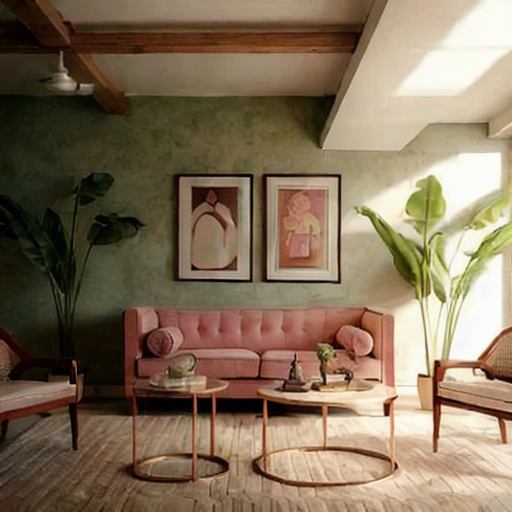
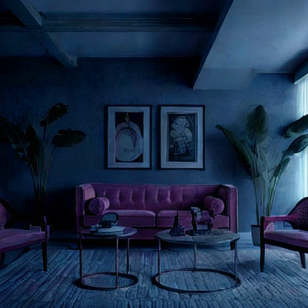
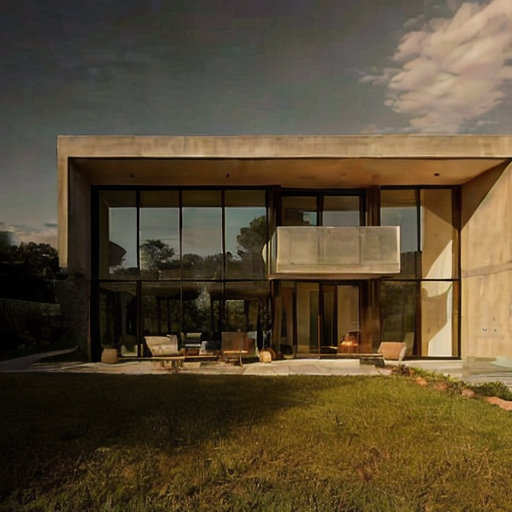
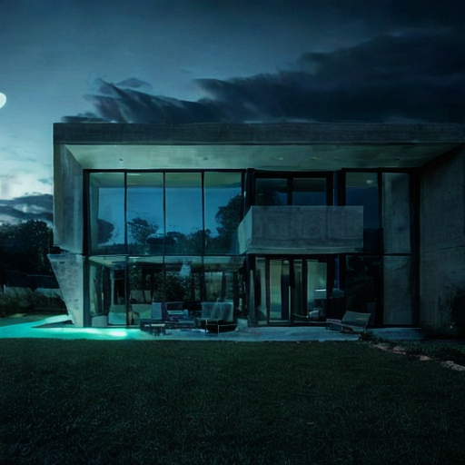
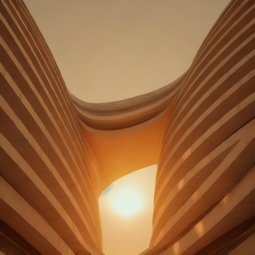
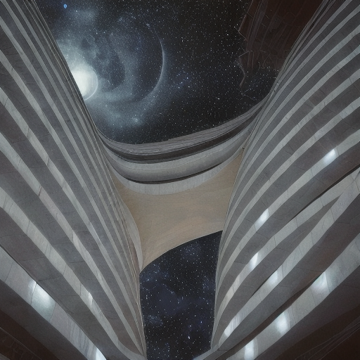
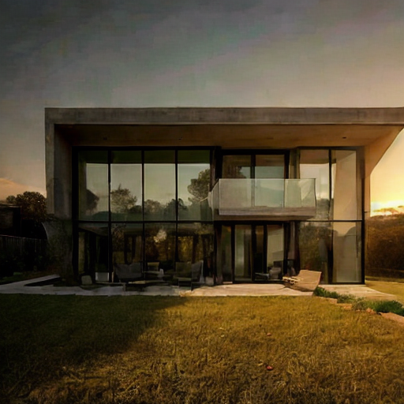
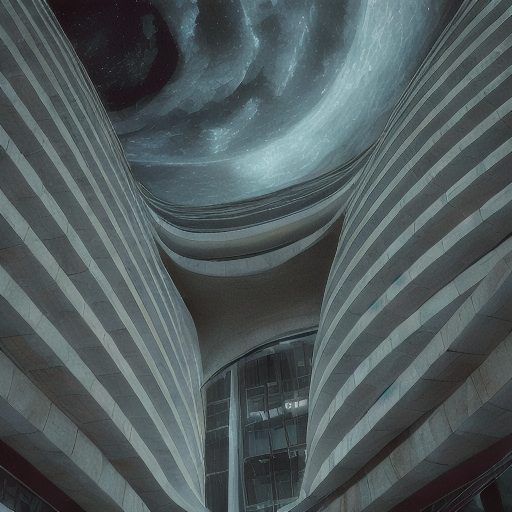
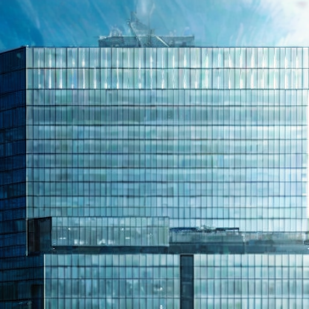
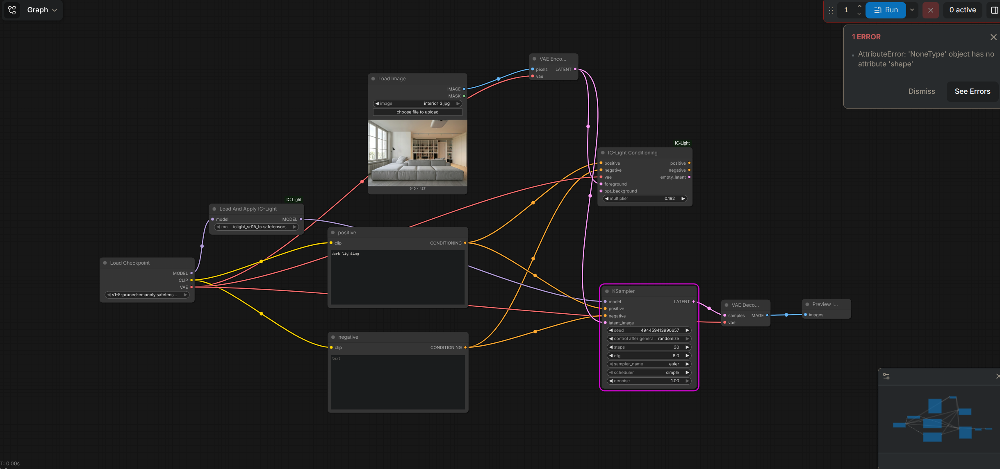

# My Setup

- **Hardware:** Lenovo Legion 5 15ARH05H with NVIDIA RTX 2060 GPU (6GB VRAM) and AMD iGPU
- **ComfyUI:** Master branch (although I could've pinned the release down just in case)
- **OS:** Void Linux glibc x86_64 with runit init system and Niri (DMS) desktop
- **Custom Nodes:** `comfyui-ic-light` - https://github.com/kijai/ComfyUI-IC-Light
- **Tooling:** `mise` - a project tooling manager that I'm obsessed with for good reason: it has tasks, env stuff and handles tool (python, node, etc) installs crossplatform

So admittedly I spent way too much time on this project, not because I wanted to impress you - that only makes up roughly 30% of my goal. I genuinely find it really exciting to mess around and figure out how to relight buildings and I came to several conclusions here based on what requirements I had set for myself specifically:
a. I wanted the surrounding sky to be reasonably believable (generative methods seemed like the fit)
b. I wanted the workflow to be really simple because I'm trying to learn to value simplicity above all

# What I Tried

Here's the rough map of what I tried:

- **IC-Light Basic:** I initially planned to use this before I even got on my laptop! It seemed very capable for its hardware value.
- **Qwen Image Edit and GGUF nodes:** I was unhappy with an issue I was facing with IC-Light Basic so I tried to switch to this... didn't end well, PC crashed and froze up as I expected.
- **ComfyUI-Relight:** VERY cheap, instant, but I wasn't happy with it because it's practically an old-school image postprocessor that can relight but it felt like it couldn't work well on certain images that involved objects such as the moon - although I may be wrong here and if so I'd really love to learn from whoever has made beautiful things with this!
- I switched back to **IC-Light Basic** because it was the first solution to work immediately, even if it required some extra generations although considering this is SD1.5 then this compromise seemed acceptable.

Issues were mostly that in the more niche image (Exterior 2), the gap under the bridge would constantly be filled by the image generator and it took me tinkering and several generations to get to an acceptable point. Although admittedly it also took me a short while to figure out how the system works since I haven't had to do image relighting so far, only character-specific detailing and generalized background changes using LoRAs.

# Production Info

- **Memory usage:** roughly ~4.4 GB
- **Cost per image?** uncertain, as we're self-hosting - that's the beauty of it :D
- **Speed:** ~4.6s/image
- I included a Dockerfile so you can push the image literally anywhere and it should work nicely!
- I didn't want to use an API solution because it seemed much more interesting to try to understand it on my own first rather than pay for an prompt-in-image-out API.

If I were to use this in a user-facing product, then I'd craft a modern React frontend as well as a Nest.js (Node)/ASP.NET (C#) API talking to Comfy API to relight images using cheaply preprocessed and deduplicated tags as prompts for the images. For example the user may take a picture of their apartment building, select preconfigured lighting tags and we will output an image that satisfies those constraints, assuming that our workflow has proven to be consistent and has detailing phases to remove artifacts.

# Experiments

**Interior**

- 
- 

**Exterior 1:**
I didn't have many issues with this one, it was a relatively straight-forward relighting.

- 
- 

**Exterior 2:**
I had a long-lasting issue with generating the night-time variant of this building due to the tool attempting to fill the gap between buildings and under the bridge, although with some tinkering I was able to overcome it.

- 
- 

**Failures:**

- 
- 
- 
- 

# How to Run

Either run it on your own system with:

```bash
mise install
mise setup
mise start (or start_cheap if lower vram)
```

Or use Docker (recommended):

```bash
docker build -t myarchitect-task .
docker run --gpus all -p 8188:8188 myarchitect-task
```

(If you're on Linux and use Nvidia, please install nvidia-container-toolkit and restart Docker so that Docker can use your Nvidia GPU)
